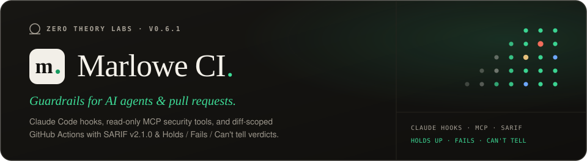

<div align="center">

<p>
  <picture>
    <source media="(prefers-color-scheme: dark)" srcset="./docs/assets/marlowe-ci-banner-dark.svg" />
    <source media="(prefers-color-scheme: light)" srcset="./docs/assets/marlowe-ci-banner-light.svg" />
    
  </picture>
</p>

<p>
  <a href="https://github.com/zerotheory-labs/marlowe-ci/releases/tag/v0.6.0"></a>&nbsp;&nbsp;
  <a href="https://www.npmjs.com/package/@zerotheory-labs/marlowe-ci"></a>&nbsp;&nbsp;
  <a href="https://registry.modelcontextprotocol.io/v0/servers?search=io.github.zerotheory-labs/marlowe-ci"></a>&nbsp;&nbsp;
  <a href="./LICENSE"></a>&nbsp;&nbsp;
  <a href="./package.json">= 20" src="https://img.shields.io/badge/node-%3E%3D20-3ddc97?style=flat-square&labelColor=181714" /></a>&nbsp;&nbsp;
  <a href="./package.json"></a>&nbsp;&nbsp;
  <a href="./server.json"></a>
</p>

<p>
  <a href="#1-claude-code-hooks--mcp-one-command"><b>Claude Code</b></a> &nbsp;·&nbsp;
  <a href="#2-universal-mcp-server-cursor-codex-windsurf-antigravity"><b>MCP Server</b></a> &nbsp;·&nbsp;
  <a href="#3-github-actions-sarif--pr-verdict-comment"><b>GitHub Action</b></a> &nbsp;·&nbsp;
  <a href="https://github.com/zerotheory-labs/marlowe"><b>Marlowe Desktop</b></a> &nbsp;·&nbsp;
  <a href="./SECURITY.md"><b>Security Policy</b></a> &nbsp;·&nbsp;
  <a href="./LICENSE"><b>License</b></a>
</p>

</div>

---

AI coding agents mutate files, run shell commands, and open pull requests in seconds. Giving an agent an unguarded shell is a liability — and shallow static scanners drown teams in unreachable alerts.

**Marlowe CI / Guard** (`v0.6.0`) brings [Marlowe](https://github.com/zerotheory-labs/marlowe)'s host-enforced security boundaries directly into **Claude Code hooks**, **MCP clients** (Claude Code, Cursor, VS Code, Codex CLI, Windsurf, Antigravity), **GitHub Actions (SARIF v2.1.0)**, and **git pre-commit** hooks with zero runtime dependencies and no LLM key required.

### What's New in `v0.6.0`
- **10-Rule Shirudo Static & Offline Verifier (`SHIRUDO-BPF-001..004`, `SHIRUDO-BEE-001..003`, `SHIRUDO-TPM-001..003`):**
  - **`.bpf.c` upatches:** Flags illegal sleepable `fmod_ret.s/` targets (`BPF-001`), missing `return 0;` or stripped `-EAGAIN` / `<= -512` / positive returns (`BPF-002`), `fmod_ret/` where `lsm/` avoids re-entrant fail-open gaps (`BPF-003`), and writes to read-only `shirudo_task_policy` / `shirudo_sock_policy` maps (`BPF-004`).
  - **`Beefile` manifests & `PreToolUse`:** Enforces selector cardinality, control-char escapes, and omitted CVE/enforcing selectors (`BEE-001`), blocks `[[upatches.rodata]]` shell/network `generator` & `update` hooks running with operator key privileges (`BEE-002`), and checks `tree.id` matching, 64-bit one-hot policy bitmasks, path glob placement, `load_target`, and TOML subset validity (`BEE-003`).
  - **TPM 2.0 & Verifier Boundaries:** Catches `shirudo status` without `--check`, self-asserted `--ak-name=$(jq ...)` / missing `--nonce`, unpinned offline `ev.json`, zero PCR 11 QEMU boots, missing `0x01818E00` PCR 9 anchors, and `reset_count` mismatches (`TPM-001..003`).
- **Expanded 33-Scenario Benchmark Suite (`npm run bench`):** Lifted Shirudo scenarios from `3/3` → `12/12` (`33/33` overall `100%` exact 3-state accuracy, `0%` clean FP rate, `18.11ms` p50).
- **SARIF First-Class `ruleId`s + Maintainer Docs:** Preserves explicit `SHIRUDO-*` rule IDs in SARIF v2.1.0 output and adds [`CLAUDE.md`](./CLAUDE.md).

---

## Three Answers, Never Two

Every audit emits one explicit verdict:

| Verdict | Meaning | Exit Code |
| :--- | :--- | :---: |
| **`HOLDS UP`** | Diff/workspace checked; no exposed secrets, reachable sinks, CVEs, or unverified guard gaps. | `0` |
| **`FAILS`** | Confirmed hardcoded secret, reachable CWE sink, TLS bypass, or vulnerable dependency $\ge$ `--fail-on`. | `1` |
| **`CAN'T TELL`** | Unknown is never rounded to a pass — triggers on unverified local sinks without external ingress, security/auth files edited without tests, scanner suppression directives (`nosemgrep`, `gitleaks:allow`), high-entropy binaries, or unavailable OSV/CLI checks. | `0` (`2` with `--fail-on-cant-tell`) |

---

## Recorded Benchmark Scorecard (`npm run bench`)

Executed offline via [`benchmarks/run-benchmarks.cjs`](./benchmarks/run-benchmarks.cjs) against 33 ephemeral Git diff repositories (`Node.js v26.12.0`, `darwin-arm64`, `0` skipped; saved in [`benchmarks/results.json`](./benchmarks/results.json)):

- **Exact 3-State Verdict Accuracy:** `33/33` (**`100%`**)
- **`FAILS` Precision / Recall / F1:** `100% / 100% / 100%` (`FP = 0`, `FN = 0`)
- **Clean / Benign False-Positive Rate:** **`0%`** (`0/9`)
- **`CAN'T TELL` Exact Match:** **`7/7`**
- **Latency (`p50` / `p95` / `mean`):** **`18.11ms` / `25.16ms` / `18.85ms`**

| Domain | Passed | Accuracy | p50 | p95 |
| :--- | :---: | :---: | :---: | :---: |
| AppSec & Cross-File Reachability | `6/6` | `100%` | `17.91ms` | `31.29ms` |
| Secrets & Masking | `3/3` | `100%` | `18.11ms` | `18.86ms` |
| Guardrail Regressions & Precision | `5/5` | `100%` | `17.93ms` | `19ms` |
| Agent Guard (Prompt Injection / Trojan / Rug-Pull) | `5/5` | `100%` | `18.11ms` | `19.23ms` |
| Shirudo eBPF, Beefile & TPM Attestation | `12/12` | `100%` | `18.28ms` | `19.54ms` |
| Binaries & Clean Refactors | `2/2` | `100%` | `16.98ms` | `18.11ms` |

---

## Quickstart

### 1. Claude Code Hooks + MCP (One Command)

Install `PreToolUse`, `PostToolUse`, and `Stop` hooks into `.claude/settings.json` plus the read-only `stdio` MCP server into `.mcp.json`:

```sh
npx --yes @zerotheory-labs/marlowe-ci init --claude --mcp
```

What gets enforced automatically inside Claude Code:
- **`PreToolUse` (`Read|Edit|Write|MultiEdit|WebFetch|Bash`):**
  - Blocks reading/writing sensitive credential paths (`.env*` excluding `.env.example`/`.sample`/`.template`, `.ssh`, `.aws`, `.gnupg`, `.shirudo`, `shirudo-keys`, `.npmrc`, `.netrc`, `*.pem`, `*.key`) and symlink escapes outside the workspace.
  - Enforces SSRF guards on `WebFetch` and `Bash` (`169.254.169.254`, `metadata.google.internal`, private RFC1918/loopback targets unless explicitly listed in `.marlowe-scope.json`).
  - Blocks `curl | sh`, Node TLS verification bypass overrides, catastrophic `rm -rf`, and credential exfiltration pipelines; prompts (`ask`) on `git push --force`, `git reset --hard`, `chmod 777`, `sudo`, `wrangler deploy`, and live **Shirudo** (`shirudo upatch load|unload|reconcile`, `shirudo bpm build|push|tree append`, `shirudo genkey|keys|init|image`).
- **`PostToolUse` (`Edit|Write|MultiEdit`):**
  - Scans modified files in milliseconds for secrets (masked before model feedback), CWE sinks, high-entropy blobs, suppression directives, and Shirudo `Beefile` / `*.bpf.c` issues so Claude fixes vulnerabilities on the next turn.
- **`Stop`:**
  - Runs a diff-scoped verdict check before Claude ends its turn and blocks completion on `FAILS` (honoring `stop_hook_active: true` to prevent loops).

---

### 2. Universal MCP Server (Cursor, VS Code, Codex, Windsurf, Antigravity)

Configure supported editors & coding agents in one command (preserves existing entries):

```sh
# Install across Cursor, VS Code, Codex CLI, Windsurf, Claude Code & .mcp.json:
npx --yes @zerotheory-labs/marlowe-ci init --all-agents

# Or target a single client:
npx --yes @zerotheory-labs/marlowe-ci init --cursor
npx --yes @zerotheory-labs/marlowe-ci init --vscode
npx --yes @zerotheory-labs/marlowe-ci init --codex
npx --yes @zerotheory-labs/marlowe-ci init --windsurf
```

Or wire `stdio` manually (listed on the [official MCP Registry](https://registry.modelcontextprotocol.io/v0/servers?search=io.github.zerotheory-labs/marlowe-ci) as `io.github.zerotheory-labs/marlowe-ci`):

```json
{
  "mcpServers": {
    "marlowe": {
      "command": "npx",
      "args": ["--yes", "@zerotheory-labs/marlowe-ci", "mcp"]
    }
  }
}
```

Exposed read-only tools (**13 total** across AppSec, Authorized Recon, DFIR & Shirudo):
- **AppSec & Supply Chain:** `marlowe_scan_diff`, `marlowe_scan_workspace`, `marlowe_audit_dependencies`, `marlowe_doctor`
- **Authorized Recon (ScopeGate-enforced):** `marlowe_check_scope`, `marlowe_inspect_http`, `marlowe_inspect_tls`, `marlowe_dns_recon`
- **DFIR (`O_NOFOLLOW`-confined):** `marlowe_triage_artifact`, `marlowe_analyze_logs`, `marlowe_extract_iocs`
- **Shirudo Runtime Upatch & TPM 2.0 Attestation:** `marlowe_shirudo_audit`, `marlowe_shirudo_verify_attestation`

---

### 3. GitHub Actions (SARIF + PR Verdict Comment)

Add `.github/workflows/marlowe-ci.yml` (or run `npx --yes @zerotheory-labs/marlowe-ci init --github`):

```yaml
name: Marlowe CI Security Guard

on:
  pull_request:

permissions:
  contents: read
  security-events: write
  pull-requests: write

jobs:
  marlowe:
    runs-on: ubuntu-latest
    steps:
      - uses: actions/checkout@v4
        with:
          fetch-depth: 0

      - uses: zerotheory-labs/marlowe-ci@v0.6.0
        with:
          mode: diff
          fail-on: high
          sarif-file: marlowe.sarif
          comment-pr: 'true'
          github-token: ${{ secrets.GITHUB_TOKEN }}

      - uses: github/codeql-action/upload-sarif@v4
        if: always() && hashFiles('marlowe.sarif') != ''
        with:
          sarif_file: marlowe.sarif
```

#### Live PR Verdict Example

Real sticky comment posted automatically on [`zerotheory-labs/marlowe#1`](https://github.com/zerotheory-labs/marlowe/pull/1):

> ## 🟡 Marlowe CI Verdict: **CAN'T TELL**
>
> > Evidence is incomplete or contains unverified sinks — never rounded to a pass.
>
> - **Mode:** `diff` · **Files inspected:** `2` · **Threshold:** `high` · **Duration:** `18ms`
>
> _No security findings detected._
>
> ### Can't Tell Items (1)
>
> - `sensitive-surface-untested` — Security-sensitive surface modified without any test changes (`.github/workflows/marlowe-ci.yml`).

---

### 4. Local Diff, Recon, DFIR & Baseline CLI

```sh
# Audit working tree & untracked files
npx --yes @zerotheory-labs/marlowe-ci scan

# Audit staged changes offline before commit
npx --yes @zerotheory-labs/marlowe-ci scan --staged --no-osv

# Acknowledge non-secret legacy findings (secrets are never baselined)
npx --yes @zerotheory-labs/marlowe-ci baseline --no-osv

# ScopeGate-enforced Recon & O_NOFOLLOW DFIR
npx --yes @zerotheory-labs/marlowe-ci recon http https://staging.example.com
npx --yes @zerotheory-labs/marlowe-ci dfir logs ./access.log
npx --yes @zerotheory-labs/marlowe-ci dfir iocs ./incident.txt

# Shirudo Beefile / Plain BPF C audit & TPM 2.0 quote verification
npx --yes @zerotheory-labs/marlowe-ci shirudo audit ./shields
npx --yes @zerotheory-labs/marlowe-ci shirudo attest ./evidence.json --nonce deadbeef
npx --yes @zerotheory-labs/marlowe-ci shirudo status

# Install .git/hooks/pre-commit & inspect 10 local security CLIs
npx --yes @zerotheory-labs/marlowe-ci init --git-hook
npx --yes @zerotheory-labs/marlowe-ci doctor
```

---

## Optional Scope Configuration (`.marlowe-scope.json`)

```json
{
  "targets": ["https://staging.example.com", "127.0.0.1:3000"],
  "allowOsv": true,
  "redactContext": true
}
```

---

## Security & License

- **Security policy & trust boundaries:** [`SECURITY.md`](./SECURITY.md)
- **License:** **[PolyForm Noncommercial License 1.0.0](./LICENSE)** — Copyright © Zero Theory Labs. Free for personal, academic, educational, non-profit, and non-commercial security research. Commercial or internal business CI/CD use requires a commercial license (`access@zerotheorylabs.com`).
